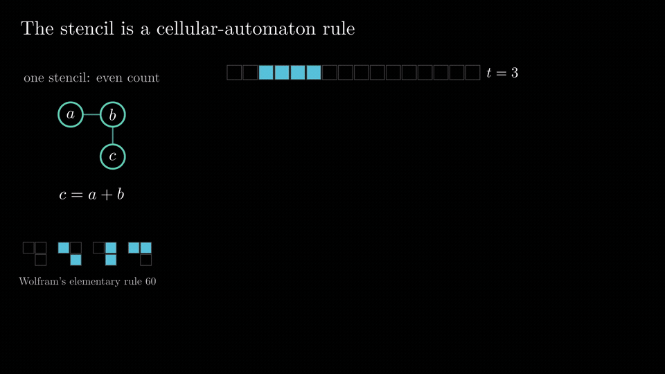
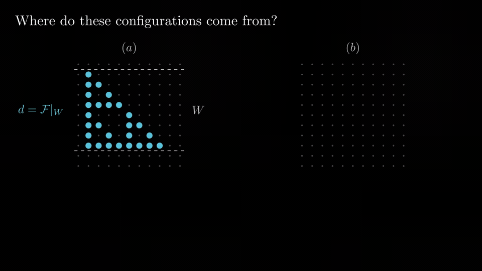
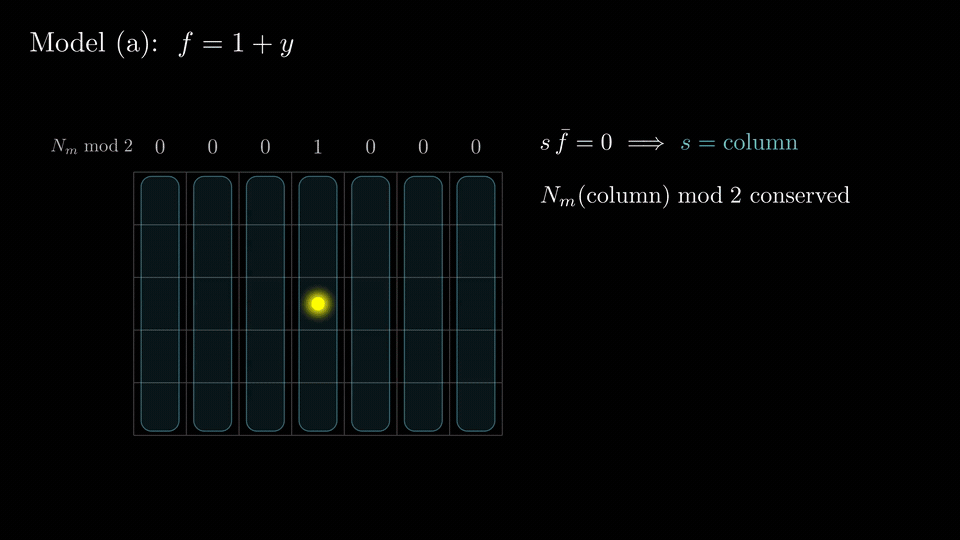

# Research Talk

**找到报告的种子，沿一条主线讲清问题，用动画展示推理，并让项目随时可以接续。**

面向科研作者的轻量 [Agent Skill](https://agentskills.io/)。作者熟悉自己的研究；模型帮助明确报告的初始动力和核心问题，组织叙事，制作关键片段打样，并完成经过审阅的动画报告。

[English](README.md) · [Skill 指令](skills/research-talk/SKILL.md) · [下载发布版本](https://github.com/Misaka16384/research-talk/releases)

## 动画演示

以下片段来自张杰宇的 HOCA 学术报告，经作者授权展示。物理内容基于 [arXiv:2401.00505](https://arxiv.org/abs/2401.00505) 和 [arXiv:2508.13961](https://arxiv.org/abs/2508.13961)。点击预览可打开或下载 1440p60 MP4。

### 从局域规则生成全局图案

[](https://github.com/Misaka16384/research-talk/releases/download/v0.1.0/demo-ca-pattern.mp4)

先展示构造和动机，再在需要计算时引入记号。

### 让公式与图中的对象对应

[](https://github.com/Misaka16384/research-talk/releases/download/v0.1.0/demo-formula-to-figure.mp4)

用颜色、位置和变换保留对应关系，让听众看到每一项的含义。

### 从守恒约束理解运动能力

[](https://github.com/Misaka16384/research-talk/releases/download/v0.1.0/demo-mobility-constraints.mp4)

先看到哪些对称荷发生改变，再判断运动是否允许。

GIF 是小预览，MP4 保留原片段的分辨率和帧率。自带的另一个通用数学示例用于环境测试；每份报告的科学内容由作者和模型共同确定。

## 一条命令安装

已有 Node/npm 时，在工作目录运行：

```bash
npx skills add Misaka16384/research-talk --skill research-talk
```

通过标准 [`skills` 安装工具](https://github.com/vercel-labs/skills) 分发，支持 Codex、Claude Code、Cursor 等多个宿主。可以交互选择，也可以指定目标。

默认是**项目级安装**：

```bash
npx skills add Misaka16384/research-talk --skill research-talk -a codex -a claude-code
```

加入 `-g` 后是**用户级全局安装**，多个项目都可使用：

```bash
npx skills add Misaka16384/research-talk --skill research-talk -a codex -a claude-code -g -y
```

各宿主决定自己的 skill 目录和调用方式。无需账号、MCP 服务器或外部生成服务；制作动画需要模型能访问本地文件并执行命令。

也可从 [Releases](https://github.com/Misaka16384/research-talk/releases) 下载独立 skill ZIP，将 `research-talk/` 解压到宿主的 skill 目录。里面包括 `SKILL.md` 和全部运行资源。可选 plugin ZIP 保留仓库结构，普通 skill 安装无需额外配置插件。

检查更新：`npx skills check`。执行更新：`npx skills update`。

## 怎么开始

按宿主支持的方式调用 `research-talk`，例如：

> 用 research-talk 帮我做一份 40 分钟的报告，材料是这两篇论文。听众包括外方向研究者。先与我讨论核心问题和主线；关键机制动画打样确认后，自主完成整份报告和审阅。

接续旧项目时：

> 用 research-talk 查找我已有的报告项目，显示当前进展，从所选项目记录的下一步继续。

提供研究材料、想讲报告的原因，以及已知的公开范围。模型在影响叙事的地方追问，提出有依据的理解和可选重心，不强制填写固定问卷。

## 协作流程

1. **访谈对齐。** 找到种子和一个核心问题，读懂材料，判断哪些内容服务于主线。
2. **重要片段打样。** 用关键机制检验讲法、视觉语言和节奏，仅做标题页不足以检验解释。
3. **确认后自主完成。** 做完整稿、检查和审阅，修复发现的问题，记录进展，不逐个 part 反复求批准。
4. **人类预览返修。** 把具体反馈提炼成原则，全篇检查同类问题。作者要求先讨论时，先确定主线改动，再统一修改。
5. **选择最终输出。** 内容确认后决定 HTML、PPTX 或两者，再最终渲染和验证。

由作者和模型按实际需要调整。页数、论文顺序、主题和阶段边界都是判断。脚本负责确定性的文件、环境、渲染和验证操作。

skill 保留了原报告中有效的问题意识：

- 技术记号前，先给听众一个值得关心的理由。
- 重要符号第一次出现，就展示它在图中指什么。
- 公式与对象有对应，跨章节保留视觉身份和联系。
- 最简单的例子第一次讲透，复杂例子按新增洞见安排篇幅。
- 关键帧可停留讲解，屏幕文字学术、简洁。
- 核对结论、引用和公开边界；共同机制不自动意味着概念包含或等价。

详见 [核心指令](skills/research-talk/SKILL.md) 和 [审阅示例](skills/research-talk/references/review.md)。

## 本地状态与不同 agent 接手

```text
my-talk/
├── PROJECT.md        # 核心问题、决定、进展、证据和下一步
├── talk.toml         # 唯一场景清单、环境和渲染配置
├── anim/             # 模型编写的场景与共享组件
├── reviews/          # 用户反馈、预览帧和审阅报告
├── .build/           # 按 profile 隔离的记录、日志、媒体与缓存
└── deck/             # 已验证的版本化导出
```

模型主动维护 `PROJECT.md`，在关键决定、修改、审阅、构建成功或中断后更新。区分计划、实现、渲染和实际验证，留下下一步已获授权的动作。详细 storyboard 和检查报告可单独存储并链接。

进入 skill 后主动探测当前工作区、配置搜索根和本地注册表中的项目。未选择项目时询问接续或新建；已明确继续时直接接手。搜索有边界，不扫描整块硬盘，运行资源随 skill 一起安装。

## 环境安装也有独立范围

安装 skill 与准备渲染环境是两个选择。

| 范围 | Skill | 渲染环境 |
|---|---|---|
| 项目级 | 当前项目的宿主 skill 目录 | `<talk>/.venv` |
| 用户／共享级 | 宿主用户目录（`-g`） | 用户配置目录中的专用环境 |
| 复用 | 任意 skill 安装范围 | 明确选择的兼容现有环境 |

首次使用主动检测依赖。获得制作授权后，询问尚未确定的范围，完成所需安装和小型测试；纯讨论可先进行。复用不会修改环境中的包，共享安装使用独立虚拟环境。安装 skill 不会自动改变系统 Python 或全局 pip 配置。

管理命令支持 Python 3.10+。测试基线是 Manim 0.19.1、Manim Slides 5.7.0。示例公式需要 LaTeX/dvisvgm；PyAV 处理视频，独立 FFmpeg 可选。平台依赖由模型按官方指引和已同意的范围处理。完整命令见 [本地操作](skills/research-talk/references/operations.md)。

## 渲染与审阅

默认预览 720p30，最终输出 **2560 × 1440、60 fps**。深色视觉、语义颜色、速度和分辨率都可调整。

按顺序渲染，隔离不同 profile 的媒体和 TeX 路径，记录日志与进程，复用成功且未过期的场景。渲染、检查、预览和导出读取同一份清单。中断后保留已完成部分，确认子进程状态再继续。

自动检查涵盖尺寸、解码帧间隔、过期或缺失媒体、越界和文字碰撞。`preview --sample all` 提取真实首帧、中间帧和末帧，默认只提取末帧。科学性、叙事和理解难度仍需审阅。没有自动告警并不等于解释清楚。

用户要求且工具支持时执行独立审阅，没有 subagent 时单独审阅并如实记录。

[渲染经验](skills/research-talk/references/rendering.md) 保留实际踩过的坑：并发缓存冲突、内存压力、孤儿进程、末帧定格、速度重复缩放、LaTeX 转义、帧率元数据误判和真实播放验证。

## HTML / PPTX 输出

| 格式 | 交付方式 |
|---|---|
| HTML | 离线交互报告，通常带同级 assets 文件夹，可选择单文件。 |
| PPTX | 内嵌 H.264/yuv420p 视频，每个 beat 一页，带自动开始的时序，公式和图属于视频内容。 |

选定格式全部通过验证后才生成新的交付目录，保留旧版本。

**Office、WPS 自动播放需要真实播放器验证。** 正常进入放映，观察视频是否自行开始；不能点击播放后声称自动播放通过。记录应用版本和结果。ZIP/XML 与编解码检查不能替代实际播放，缺少某个应用时明确保留验证缺口。

## 验证与开发

0.1.0 已通过 Windows/Linux CI、包结构检查、确定性逻辑测试、实际 1440p60 渲染与解码帧间隔检查、HTML/PPTX 导出、缓存复用，以及公开仓库的隔离安装。安装后的管理命令、项目创建和发现也已验证。

开发机尚未验证真实 Office/WPS 播放，WPS 不可用，此项仍待验证。

```bash
python tools/validate_package.py
python -m unittest discover -s tests
python tools/package.py
```

CI 在 Ubuntu、Windows 检查包与确定性逻辑，本地渲染和真实播放另行验证。推送与 `plugin.json` 一致的版本 tag 后生成两个 ZIP。[开发状态](PROJECT.md) 记录证据与待办。

## 许可与研究材料

Skill 和工具采用 MIT，随包 Tomli 2.4.1 保留其 MIT 许可。演示经作者授权，科学内容见所引论文。私人研究留在已授权的本地项目内，不复制进共享 skill 或公开发布包。
